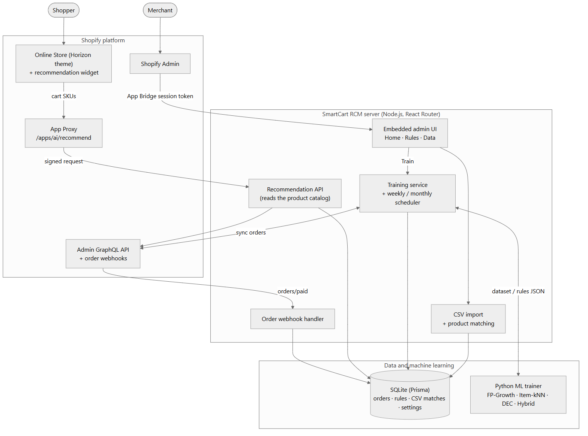
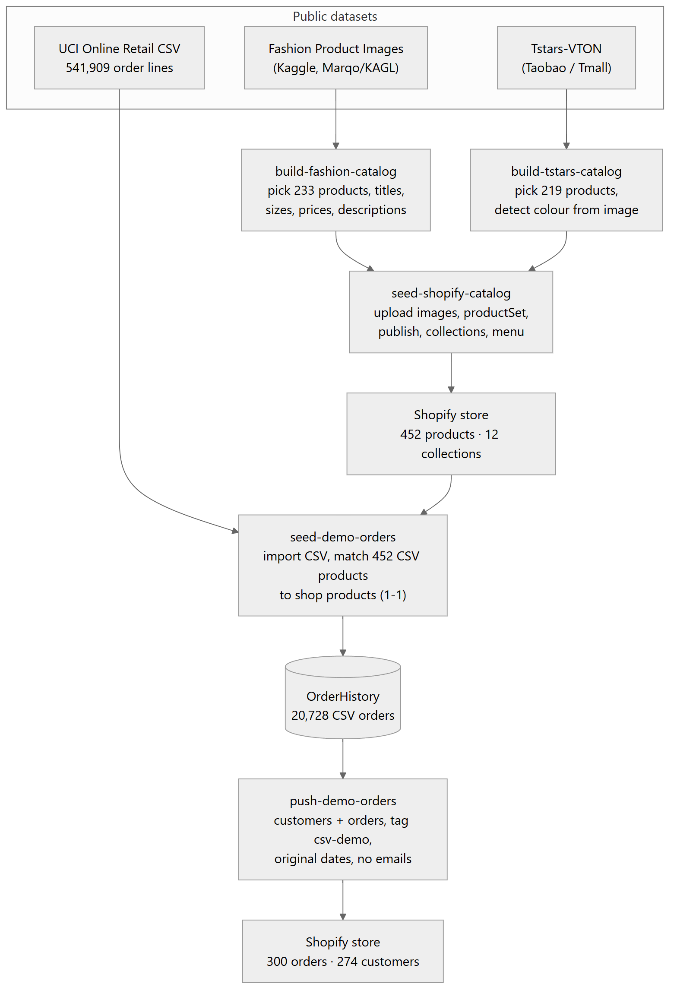
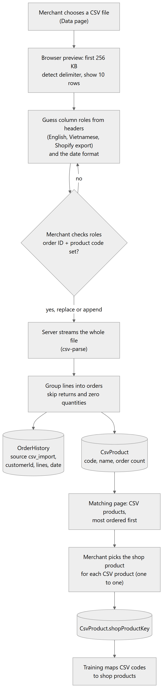
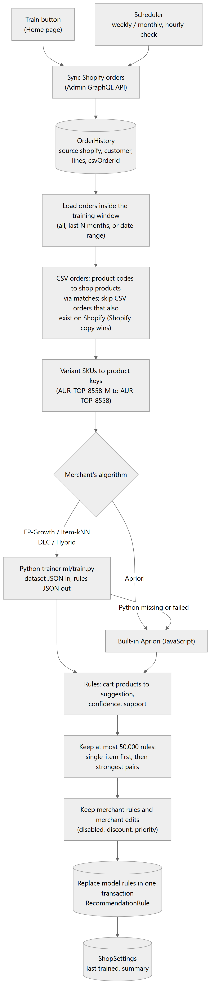
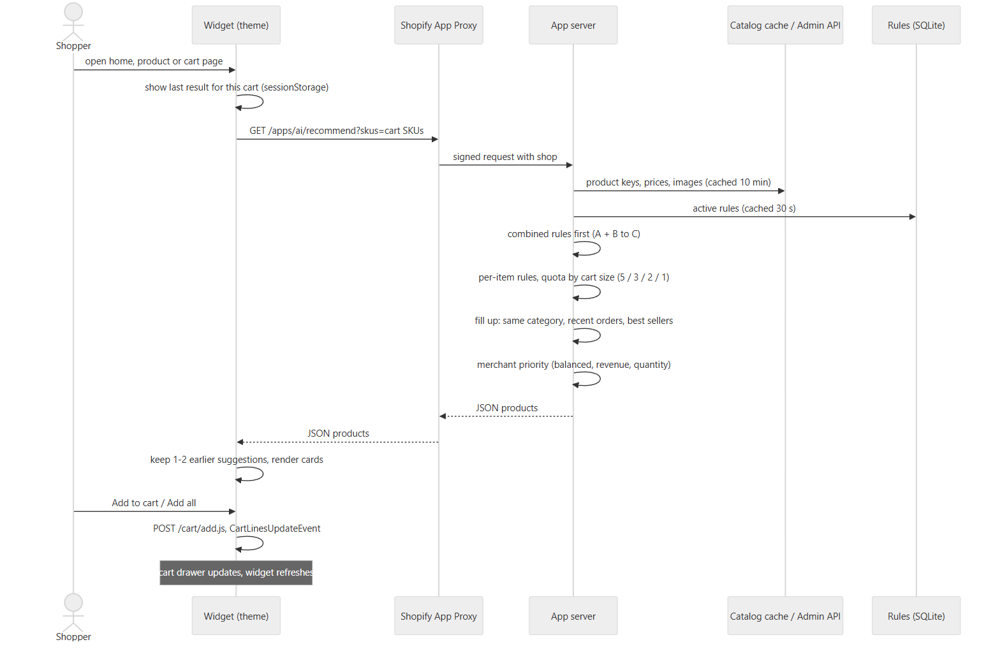
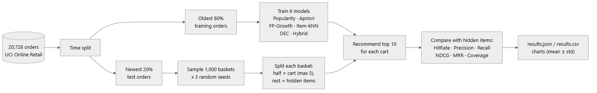
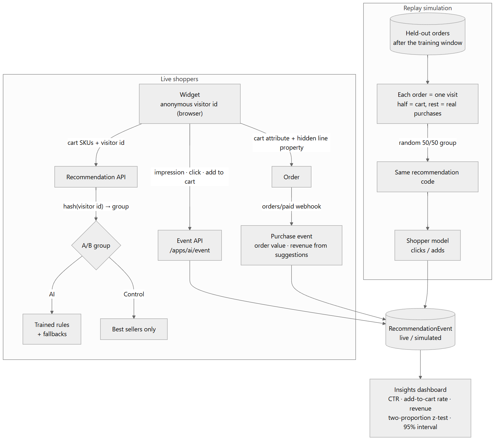

# System flows: SmartCart RCM

Diagrams for the report. Vietnamese version: [README.vi.md](README.vi.md).
Sources are Mermaid files in `src/en` and `src/vi`; images are in `img/`.
After editing a source, run `npm run docs:diagrams` (from `my-plugin-ai/`) to redraw the PNGs.

## 1. System architecture

- **Merchants** use the embedded admin app inside Shopify Admin. App Bridge adds a session token to every request.
- **Shoppers** see the recommendation widget, a theme app extension, on the home, product and cart pages.
- The widget calls the app through the **Shopify App Proxy**. Requests go to the shop's own domain and are signed by Shopify, so no tunnel URL is hard-coded.
- The **training service** syncs orders from the Admin API and trains rules. The Python algorithms run in a separate process.
- All app data is stored in **SQLite through Prisma**:
  - orders (CSV and Shopify)
  - rules
  - CSV product matches
  - shop settings

## 2. Demo store data

- The demo store `my-favsion.myshopify.com` is built only by scripts, from public datasets:
  - **233 products** from Fashion Product Images.
  - **219 Asian-style products** from Tstars-VTON (Taobao/Tmall).
- Order history comes from the UCI Online Retail CSV. Its 452 best-selling products are matched one to one to the shop's products. Co-purchased items keep the same gender and get complementary departments.
- **300 of these orders** are recreated on Shopify, with **274 customers**. They are tagged `csv-demo` and linked to their CSV order.

## 3. CSV import and product matching

- **Any CSV layout is accepted:**
  - The merchant previews the first rows and confirms what each column contains.
  - Roles are guessed from English, Vietnamese and Shopify-export headers.
- **The server streams the whole file** (541,909 lines in about 4 s):
  - Lines are grouped into orders; returns are skipped.
  - Each order is stored with its customer and lines.
- **Matching page:** the merchant links each CSV product to one shop product. Training only uses matched products.

## 4. Training

- **Trigger:** the Train button, or the weekly / monthly scheduler.
- **Data used:**
  - Only orders inside the merchant's date window.
  - When an order exists both as a CSV order and on Shopify, the Shopify copy is used.
  - Sizes of one product count as one product.
- **Algorithm:**
  - FP-Growth, Item-kNN, DEC and Hybrid run in Python.
  - If Python is missing or fails, the built-in Apriori is used, so training always finishes.
- **Saving rules:**
  - At most 50,000 rules are kept.
  - Merchant rules and merchant edits (disabled, discount, priority) are preserved.
  - Model rules are replaced in one transaction.

## 5. Recommendation

- **Instant display:** the widget first shows the last result for the same cart, then asks the app for fresh suggestions.
- **Order of suggestions:**
  1. Combined rules (A + B gives C).
  2. Each cart item's own rules. More suggestions per item for small carts: 5, 3, 2, then 1 per item.
  3. Fill-ups so the widget is never empty: same category, recent orders, best sellers.
- **Ranking:** follows the merchant's priority (balanced, revenue, or quantity).
- **When the cart changes:** one or two earlier suggestions are kept.
- **Add to cart / Add all:** updates the theme's cart drawer through Shopify's standard cart event.

## 6. Offline evaluation

- **Time split:**
  - Models learn from the oldest 80% of orders.
  - They are tested on the newest 20%.
- **Each test:**
  - Half of a real basket is the cart; the rest are hidden items.
  - A model scores when its top 10 contains hidden items.
- **Repetition:** 1,000 baskets × 3 random seeds, reported as mean ± standard deviation.
- **Results:** in [`../eval/README.md`](../eval/README.md). FP-Growth is best: HitRate@10 0.782 vs 0.745 for the Apriori baseline.

## 7. Measurement and A/B test

- **Live shoppers:**
  - Each browser gets an anonymous visitor id. The server puts the visitor in a group from a hash of that id: AI suggestions, or best sellers (control).
  - The widget sends impressions, clicks and adds to `/apps/ai/event`.
  - Purchases come from the `orders/paid` webhook. A cart attribute and a hidden line property link the order to the widget.
- **Replay simulation:**
  - Held-out orders become visits.
  - Each visit goes through the same recommendation code.
  - A shopper model decides clicks and adds.
- **Insights page:**
  - Shows click rate, add-to-cart rate and revenue from suggestions per group.
  - Runs a two-proportion z-test.
- **Results:** in [`../eval/AB_TEST.md`](../eval/AB_TEST.md).
