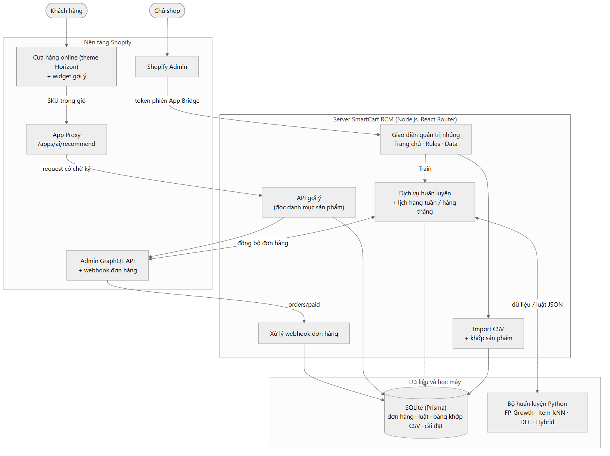
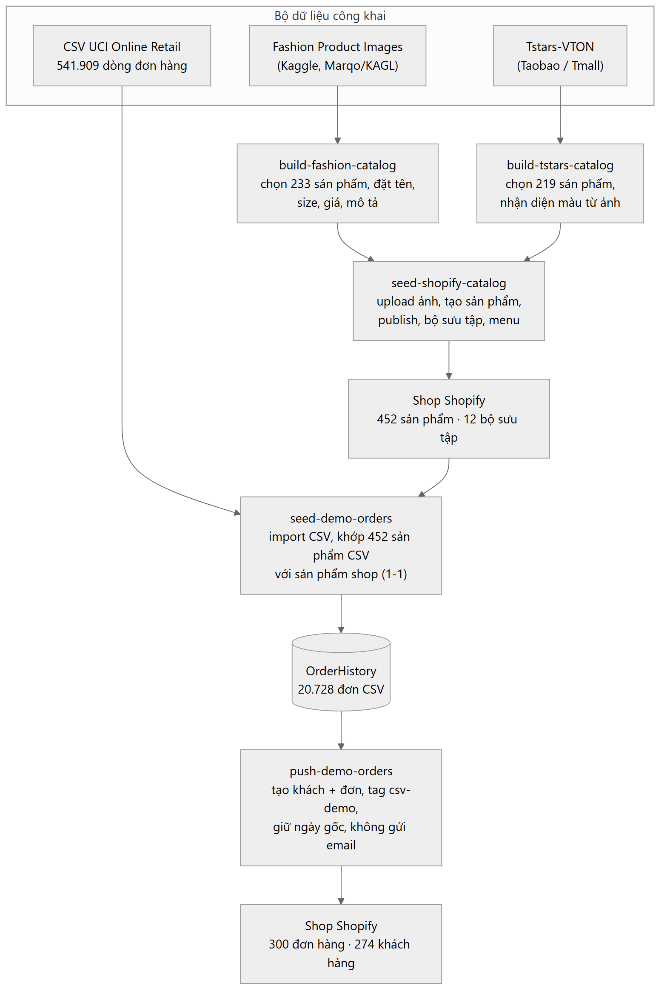
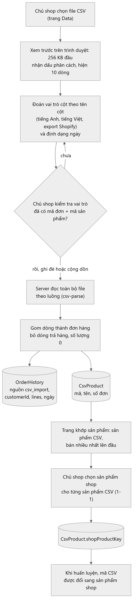
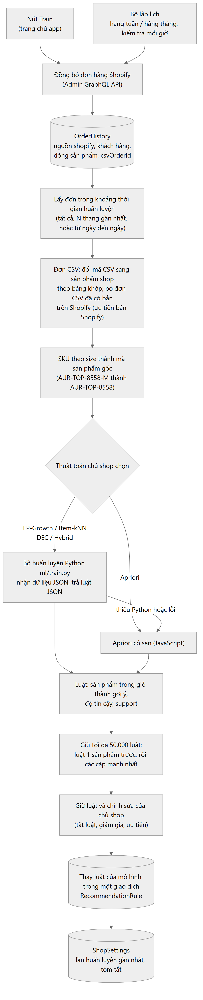
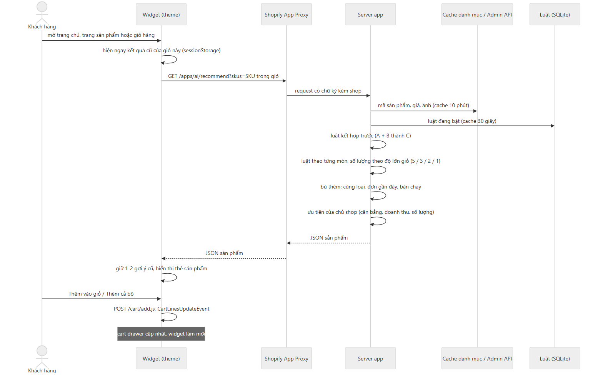
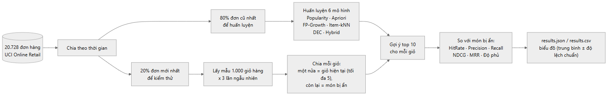
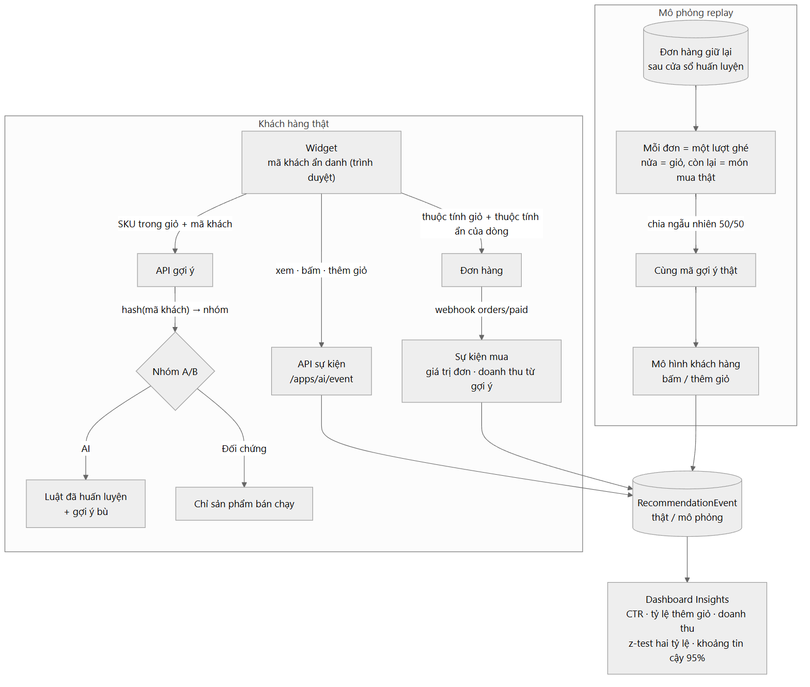

# Quy trình hệ thống: SmartCart RCM

Bản tiếng Anh: [README.md](README.md).
Mã nguồn sơ đồ (Mermaid) nằm trong `src/vi`, ảnh nằm trong `img/` (đuôi `.vi.png`).
Sau khi sửa sơ đồ, chạy `npm run docs:diagrams` (trong thư mục `my-plugin-ai/`) để vẽ lại ảnh.

## 1. Kiến trúc hệ thống

- **Chủ shop** dùng app quản trị nhúng trong Shopify Admin. App Bridge tự gắn token phiên vào mọi request.
- **Khách hàng** thấy widget gợi ý (theme app extension) ở trang chủ, trang sản phẩm và giỏ hàng.
- Widget gọi app qua **Shopify App Proxy**. Request đi qua chính domain của shop và được Shopify ký xác thực, nên không phụ thuộc đường dẫn tạm thời.
- **Dịch vụ huấn luyện** đồng bộ đơn hàng từ Admin API và sinh luật. Các thuật toán Python chạy ở một tiến trình riêng.
- Toàn bộ dữ liệu của app nằm trong **SQLite (qua Prisma)**:
  - đơn hàng (CSV và Shopify)
  - luật gợi ý
  - bảng khớp sản phẩm CSV
  - cài đặt của shop

## 2. Dữ liệu shop demo

- Shop demo `my-favsion.myshopify.com` được dựng hoàn toàn bằng script, từ các bộ dữ liệu công khai:
  - **233 sản phẩm** từ Fashion Product Images.
  - **219 sản phẩm phong cách châu Á** từ Tstars-VTON (Taobao/Tmall).
- Lịch sử đơn hàng lấy từ file CSV UCI Online Retail. 452 sản phẩm bán chạy nhất trong CSV được khớp 1-1 với sản phẩm của shop; các món hay mua cùng nhau được giữ cùng giới tính và vào các nhóm hàng bổ trợ nhau.
- **300 đơn trong số đó** được tạo lại trên Shopify, kèm **274 khách hàng**. Các đơn có tag `csv-demo` và được nối với đơn CSV gốc.

## 3. Import CSV và khớp sản phẩm

- **Nhận file CSV với cấu trúc cột bất kỳ:**
  - Chủ shop xem trước vài dòng và xác nhận ý nghĩa từng cột.
  - Vai trò cột được đoán sẵn theo tên cột tiếng Anh, tiếng Việt và file export của Shopify.
- **Server đọc toàn bộ file theo luồng** (541.909 dòng trong khoảng 4 giây):
  - Gom các dòng thành đơn hàng, bỏ dòng trả hàng.
  - Lưu mỗi đơn kèm khách hàng và từng dòng sản phẩm.
- **Trang khớp sản phẩm:** chủ shop nối mỗi sản phẩm CSV với một sản phẩm của shop. Khi huấn luyện, chỉ các sản phẩm đã khớp được dùng.

## 4. Huấn luyện

- **Kích hoạt:** nút Train, hoặc bộ lập lịch hàng tuần / hàng tháng.
- **Dữ liệu được dùng:**
  - Chỉ các đơn nằm trong khoảng thời gian chủ shop chọn.
  - Đơn có cả bản CSV lẫn bản Shopify thì dùng bản Shopify.
  - Các size của cùng một sản phẩm được tính là một sản phẩm.
- **Thuật toán:**
  - FP-Growth, Item-kNN, DEC và Hybrid chạy bằng Python.
  - Nếu thiếu Python hoặc Python lỗi, app dùng Apriori có sẵn, nên lần huấn luyện luôn hoàn thành.
- **Lưu luật:**
  - Giữ tối đa 50.000 luật.
  - Luật và chỉnh sửa của chủ shop (tắt luật, giảm giá, ưu tiên) được giữ nguyên.
  - Luật của mô hình được thay trong một giao dịch duy nhất.

## 5. Gợi ý sản phẩm

- **Hiển thị tức thì:** widget hiện ngay kết quả cũ của cùng giỏ hàng, rồi mới hỏi app lấy gợi ý mới.
- **Thứ tự ưu tiên khi chọn gợi ý:**
  1. Luật kết hợp (A + B thành C).
  2. Luật theo từng món trong giỏ. Giỏ càng ít món thì mỗi món càng nhiều gợi ý: 5, 3, 2 rồi 1 gợi ý mỗi món.
  3. Gợi ý bù để widget không bao giờ trống: cùng loại, đơn gần đây, bán chạy.
- **Xếp hạng:** theo ưu tiên của chủ shop (cân bằng, doanh thu hoặc số lượng bán).
- **Khi giỏ hàng thay đổi:** giữ lại 1–2 gợi ý cũ.
- **Nút "Thêm vào giỏ" / "Thêm cả bộ":** cập nhật cart drawer của theme qua sự kiện giỏ hàng chuẩn của Shopify.

## 6. Đánh giá offline

- **Chia đơn theo thời gian:**
  - Mô hình học từ 80% đơn cũ nhất.
  - Mô hình được kiểm thử trên 20% đơn mới nhất.
- **Mỗi lần kiểm thử:**
  - Một nửa giỏ hàng thật được coi là giỏ hiện tại, nửa còn lại là các món bị ẩn.
  - Mô hình ghi điểm khi top 10 gợi ý có chứa món bị ẩn.
- **Lặp lại:** 1.000 giỏ × 3 lần ngẫu nhiên, báo cáo trung bình ± độ lệch chuẩn.
- **Kết quả:** xem [`../eval/README.md`](../eval/README.md). FP-Growth tốt nhất: HitRate@10 đạt 0,782, so với 0,745 của Apriori ban đầu.

## 7. Đo lường và A/B test

- **Khách hàng thật:**
  - Mỗi trình duyệt có một mã khách ẩn danh. Server chia khách vào nhóm theo hash của mã này: nhóm gợi ý AI, hoặc nhóm chỉ thấy sản phẩm bán chạy (đối chứng).
  - Widget gửi các sự kiện xem, bấm, thêm giỏ về `/apps/ai/event`.
  - Sự kiện mua lấy từ webhook `orders/paid`. Thuộc tính giỏ hàng và thuộc tính ẩn của dòng sản phẩm cho biết đơn đến từ widget.
- **Mô phỏng replay:**
  - Các đơn hàng được giữ lại (model chưa từng thấy) trở thành lượt ghé.
  - Mỗi lượt đi qua đúng mã gợi ý thật.
  - Một mô hình khách hàng quyết định bấm và thêm giỏ.
- **Trang Insights:**
  - Hiện tỷ lệ bấm, tỷ lệ thêm giỏ và doanh thu từ gợi ý của từng nhóm.
  - Kiểm định bằng z-test hai tỷ lệ.
- **Kết quả:** xem [`../eval/AB_TEST.md`](../eval/AB_TEST.md).
